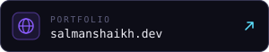
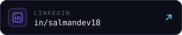
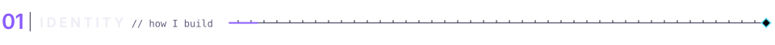
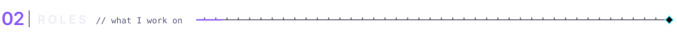
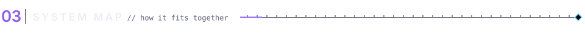
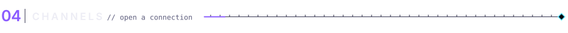
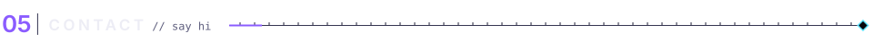

<!--
  Profile README for salmanshaikh18.
  Custom visuals live in ./assets and are generated by scripts/build_assets.py
  (edit copy or colours there, then re-run). Every visual ships a dark and a
  light variant, switched by GitHub's theme through <picture>.
-->

<picture>
  <source media="(prefers-color-scheme: dark)" srcset="./assets/hero-dark.svg">
  <source media="(prefers-color-scheme: light)" srcset="./assets/hero-light.svg">
  
</picture>

<p align="center">
  <a href="https://salmanshaikh.dev"><picture><source media="(prefers-color-scheme: dark)" srcset="./assets/link-portfolio-dark.svg"><source media="(prefers-color-scheme: light)" srcset="./assets/link-portfolio-light.svg"></picture></a>
  <a href="https://linkedin.com/in/salmandev18"><picture><source media="(prefers-color-scheme: dark)" srcset="./assets/link-linkedin-dark.svg"><source media="(prefers-color-scheme: light)" srcset="./assets/link-linkedin-light.svg"></picture></a>
  <a href="mailto:dev.salmanshaikh@gmail.com"><picture><source media="(prefers-color-scheme: dark)" srcset="./assets/link-email-dark.svg"><source media="(prefers-color-scheme: light)" srcset="./assets/link-email-light.svg"></picture></a>
</p>

<br>

<picture>
  <source media="(prefers-color-scheme: dark)" srcset="./assets/section-01-dark.svg">
  <source media="(prefers-color-scheme: light)" srcset="./assets/section-01-light.svg">
  
</picture>

Hey, I'm Salman, a full stack developer from Mumbai. I've spent the last 2+ years building production apps end to end: the React or Next.js frontend, the Node.js or FastAPI backend, the database, and the Docker and AWS setup it all runs on.

These days I'm also learning how to build with AI agents and RAG, and reading a lot about system design.

```ts
const salman = {
  name:       "Salman Shaikh",
  base:       "Mumbai, India",
  role:       "Full Stack Developer",
  roles:      ["frontend", "backend", "devops", "genai"],
  experience: "2+ years",
  ships:      ["web + mobile UIs", "APIs", "data layers", "deployments"],
  operates:   ["AWS", "Docker", "Linux", "Nginx", "GitHub Actions"],
  observes:   ["Prometheus", "Grafana", "Loki", "SonarQube"],
  exploring:  ["AI agents", "RAG", "LangGraph", "MCP", "Ollama", "system design"],
} as const;
```

<br>

<picture>
  <source media="(prefers-color-scheme: dark)" srcset="./assets/section-02-dark.svg">
  <source media="(prefers-color-scheme: light)" srcset="./assets/section-02-light.svg">
  
</picture>

<picture>
  <source media="(prefers-color-scheme: dark)" srcset="./assets/roles-dark.svg">
  <source media="(prefers-color-scheme: light)" srcset="./assets/roles-light.svg">
  
</picture>

<br>

<picture>
  <source media="(prefers-color-scheme: dark)" srcset="./assets/section-03-dark.svg">
  <source media="(prefers-color-scheme: light)" srcset="./assets/section-03-light.svg">
  
</picture>

<picture>
  <source media="(prefers-color-scheme: dark)" srcset="./assets/system-map-dark.svg">
  <source media="(prefers-color-scheme: light)" srcset="./assets/system-map-light.svg">
  
</picture>


<br>

<picture>
  <source media="(prefers-color-scheme: dark)" srcset="./assets/section-04-dark.svg">
  <source media="(prefers-color-scheme: light)" srcset="./assets/section-04-light.svg">
  
</picture>

<p align="center">
  <picture>
    <source media="(prefers-color-scheme: dark)" srcset="https://streak-stats.demolab.com/?user=salmanshaikh18&background=0D0D17&border=33334F&stroke=33334F&ring=8B5CFF&fire=5CE1FF&currStreakNum=EDEDF5&sideNums=EDEDF5&currStreakLabel=5CE1FF&sideLabels=9A9AB4&dates=5F5F7E&border_radius=10">
    <source media="(prefers-color-scheme: light)" srcset="https://streak-stats.demolab.com/?user=salmanshaikh18&background=FFFFFF&border=CDC8E4&stroke=CDC8E4&ring=6A3DF0&fire=0A8BAF&currStreakNum=0E0B1F&sideNums=0E0B1F&currStreakLabel=0A8BAF&sideLabels=55536E&dates=8E8BA8&border_radius=10">
    
  </picture>
</p>

<p align="center">
  <picture>
    <source media="(prefers-color-scheme: dark)" srcset="https://github-readme-activity-graph.vercel.app/graph?username=salmanshaikh18&bg_color=0D0D17&color=9A9AB4&title_color=EDEDF5&line=8B5CFF&point=5CE1FF&area=true&area_color=8B5CFF&hide_border=true&radius=10&custom_title=Contribution%20activity">
    <source media="(prefers-color-scheme: light)" srcset="https://github-readme-activity-graph.vercel.app/graph?username=salmanshaikh18&bg_color=FFFFFF&color=55536E&title_color=0E0B1F&line=6A3DF0&point=0A8BAF&area=true&area_color=6A3DF0&hide_border=true&radius=10&custom_title=Contribution%20activity">
    
  </picture>
</p>

<p align="center">
  <picture>
    <source media="(prefers-color-scheme: dark)" srcset="https://raw.githubusercontent.com/salmanshaikh18/salmanshaikh18/output/github-contribution-grid-snake-dark.svg">
    <source media="(prefers-color-scheme: light)" srcset="https://raw.githubusercontent.com/salmanshaikh18/salmanshaikh18/output/github-contribution-grid-snake.svg">
    
  </picture>
</p>

<br>

<picture>
  <source media="(prefers-color-scheme: dark)" srcset="./assets/section-05-dark.svg">
  <source media="(prefers-color-scheme: light)" srcset="./assets/section-05-light.svg">
  
</picture>

| | Where | For |
| :-- | :-- | :-- |
| `https` | [salmanshaikh.dev](https://salmanshaikh.dev) | My projects and more about me |
| `linkedin` | [in/salmandev18](https://linkedin.com/in/salmandev18) | Job opportunities and work stuff |
| `smtp` | [dev.salmanshaikh@gmail.com](mailto:dev.salmanshaikh@gmail.com) | Ideas, questions, or just to say hi |

<br>

<picture>
  <source media="(prefers-color-scheme: dark)" srcset="./assets/footer-dark.svg">
  <source media="(prefers-color-scheme: light)" srcset="./assets/footer-light.svg">
  
</picture>
